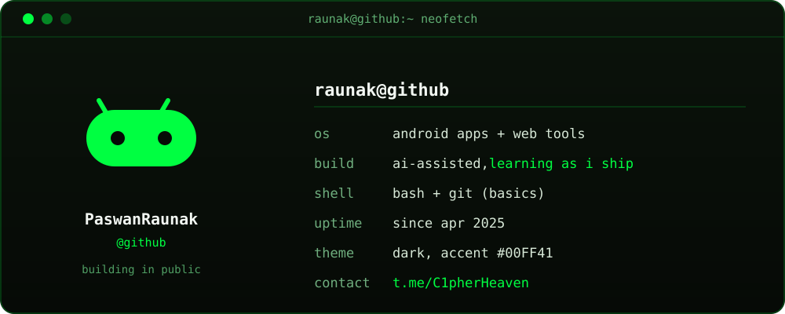
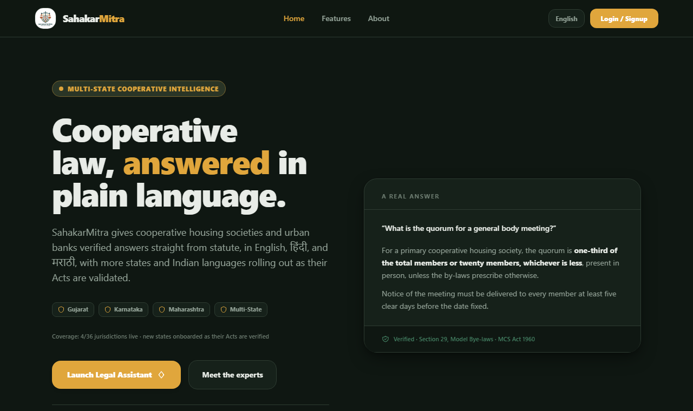
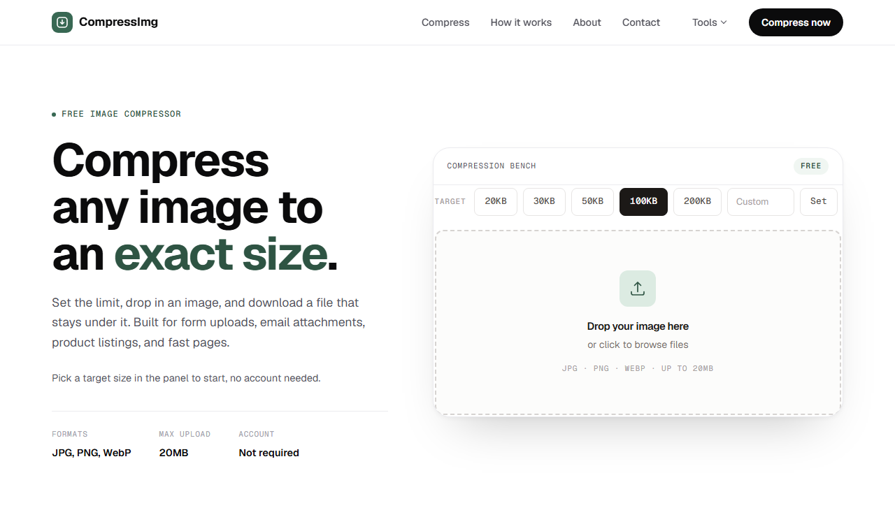

<p align="center">
  
  &nbsp;
  
  &nbsp;
  
</p>




## Projects

**athermate, on a real device**

<p align="center">
  <a href="https://github.com/PaswanRaunak/athermate">
    
  </a>
  <a href="https://github.com/PaswanRaunak/athermate">
    
  </a>
  <a href="https://github.com/PaswanRaunak/athermate">
    
  </a>
</p>

**web tools, running live**

<table>
  <tr>
    <td width="50%">
      <a href="https://github.com/PaswanRaunak/sahakarmitra">
        
      </a>
    </td>
    <td width="50%">
      <a href="https://github.com/PaswanRaunak/imgcompressor">
        
      </a>
    </td>
  </tr>
</table>

<table>
  <tr>
    <td width="50%">
      <a href="https://github.com/PaswanRaunak/athermate">
        
      </a>
    </td>
    <td width="50%">
      <a href="https://github.com/PaswanRaunak/athermate-archive">
        
      </a>
    </td>
  </tr>
  <tr>
    <td width="50%">
      <a href="https://github.com/PaswanRaunak/compressimg">
        
      </a>
    </td>
    <td width="50%">
      <a href="https://github.com/PaswanRaunak/sahakarmitra">
        
      </a>
    </td>
  </tr>
  <tr>
    <td width="50%">
      <a href="https://github.com/PaswanRaunak/NER-Connect">
        
      </a>
    </td>
    <td width="50%">
      <a href="https://github.com/PaswanRaunak/ap-fraud-sentinel">
        
      </a>
    </td>
  </tr>
</table>

## Tools I use


## Stats

<table>
  <tr>
    <td>
      
    </td>
    <td>
      
    </td>
  </tr>
</table>


## Activity


## Contribution graph

<picture>
  <source media="(prefers-color-scheme: dark)" srcset="https://raw.githubusercontent.com/PaswanRaunak/PaswanRaunak/output/github-contribution-grid-snake-dark.svg" />
  
</picture>


## Connect

<p align="center">
  <a href="https://t.me/C1pherHeaven">
    
  </a>
</p>

```console
$ exit
connection to github closed
```


